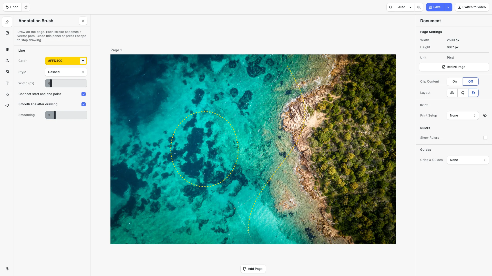

# Annotation Brush for CE.SDK

An example application for [CE.SDK](https://img.ly/creative-sdk) by [IMG.LY](https://img.ly). It adds a free-hand annotation brush to the web editor: users draw on an image or a video, and each stroke becomes an editable vector path with a dashed, dotted or solid line.



The brush is a CE.SDK plugin in [`src/annotation-brush`](./src/annotation-brush). It is not published on npm. Copy the folder into your own application to use it.

## Features

- **Free-hand strokes** that become `vector_path` blocks. Users can move, restyle and reshape them like any other shape, and **Edit Path** moves single points.
- **Line style:** color, style (dashed, dotted, solid …) and width.
- **Areas:** connect the start and end point to outline an area.
- **Smoothing:** removes hand jitter, with an adjustable strength.
- **Video:** in the video editor, each stroke becomes a timeline clip that starts at the playhead.
- **Input:** mouse, pen and touch. While a stroke is in progress, other fingers or buttons do not select or move blocks.
- **Labels** in English and German.

## Run the example

You need Node.js 20 or newer.

```bash
git clone https://github.com/imgly/poc-annotation-brush-web.git
cd poc-annotation-brush-web
npm install
cp .env.example .env
npm run dev
```

Open `http://localhost:5173`. Add your CE.SDK license key to `.env` as `VITE_CESDK_LICENSE`. Without a key, the editor runs in evaluation mode with a watermark.

1. Click **Annotation Brush** at the top of the dock. The panel opens.
2. Set the color, style and width, and draw on the photo. When you release, the stroke becomes a vector path.
3. Turn on **Connect start and end point** and draw a loop to outline an area.
4. Press Escape or close the panel to stop drawing. Select a stroke and click **Edit Path** to move its points.
5. Click **Switch to video** in the top bar, or open `http://localhost:5173/?mode=video`. Move the playhead and draw. The stroke appears in the timeline as a clip.

## Use the brush in your application

1. Copy `src/annotation-brush` into your project. It needs only `@cesdk/cesdk-js` and `@cesdk/engine`.
2. Add the plugin after you create the editor:

```ts
import CreativeEditorSDK from '@cesdk/cesdk-js';
import AnnotationBrushPlugin from './annotation-brush';

const cesdk = await CreativeEditorSDK.create('#editor', config);
await cesdk.addPlugin(
  AnnotationBrushPlugin({
    ui: { locations: 'dock' },
    defaults: { style: 'Dashed', width: 6 },
    onStrokeCreated: (block) => {
      const shape = cesdk.engine.block.getShape(block);
      // The SVG path data of the new stroke, for example to store it in your backend.
      console.log(cesdk.engine.block.getString(shape, 'shape/vector_path/path'));
    }
  })
);
```

`src/imgly/plugins/annotation-brush.ts` shows the same setup, and puts the button first in the dock.

### Options

| Option | Default | Description |
| --- | --- | --- |
| `ui.locations` | none | `'dock'` adds the **Annotation Brush** button at the end of the dock. Leave it out to place the button yourself. |
| `defaults.color` | yellow | Stroke color. |
| `defaults.style` | `'Dashed'` | Any CE.SDK stroke style. |
| `defaults.width` | `6` | Stroke width in pixels. The plugin converts it to the scene's design unit, for example about 0.5 mm on a millimeter page at 300 DPI. |
| `defaults.closePath` | `false` | Joins the end point back to the start point. |
| `defaults.smooth` | `true` | Removes hand jitter and fits a smooth curve. |
| `defaults.smoothing` | `3` | Smoothing strength, 1 to 10. |
| `defaults.clipDuration` | `5` | Seconds a stroke stays visible from the playhead. Video editors only. |
| `onStrokeCreated` | none | Called with the block ID of each new stroke. |

The defaults set the starting values of the panel controls. Users can change them in the panel.

### IDs

| Export | Value | Use |
| --- | --- | --- |
| `ANNOTATION_BRUSH_DOCK_COMPONENT_ID` | `ly.img.annotationBrush.dock` | The button component. Add it to any UI area. |
| `ANNOTATION_BRUSH_PANEL_ID` | `//ly.img.panel/annotationBrush` | The panel. Open it with `cesdk.ui.openPanel()` to start drawing from your own UI. |
| `STROKE_METADATA_KEY` | `annotation-brush` | Metadata key on every stroke block. Use it to find the strokes in a scene. |
| `translationKeys` | | All label keys. Set your own text with `cesdk.i18n.setTranslations()`. |

## How it works

- While the panel is open, the plugin takes pointer input on the canvas before the editor does, and draws a live preview line.
- On release it smooths the points, removes points that add no detail, and fits a curve through the rest. The result is the SVG path data of a `vector_path` shape.
- Drawing is on only while the panel is open. CE.SDK has no event for a closed panel, so the plugin checks once per frame while drawing is on.
- In a video editor (`ly.img.video.timeline` enabled), each stroke gets a time offset at the playhead and a duration. Near the end of the video, the clip moves back so it still fits.

## Project structure

```
public/assets/                 # Demo photo and video
src/
├── annotation-brush/          # The plugin: copy this folder into your app
│   ├── plugin.ts              # Panel, dock button, options, timeline handling
│   ├── input.ts               # Pointer input and live preview
│   ├── geometry.ts            # Smoothing, simplification, curve fitting
│   ├── stroke.ts              # Creates the vector path block
│   └── constants.ts           # IDs, translation keys, labels
├── imgly/
│   ├── config/                # Advanced design and video editor configuration
│   ├── plugins/annotation-brush.ts
│   └── index.ts               # Editor setup for design and video mode
└── index.ts                   # Creates the editor and the demo scene
```

## Compatibility

Built and tested with CE.SDK 1.84.0 in current Chrome, Edge, Firefox and Safari. The brush works in the web editor only.

## License

This repository, including the plugin in `src/annotation-brush`, is licensed under the MIT License, see [LICENSE](LICENSE). Using CE.SDK itself requires a CE.SDK license.
